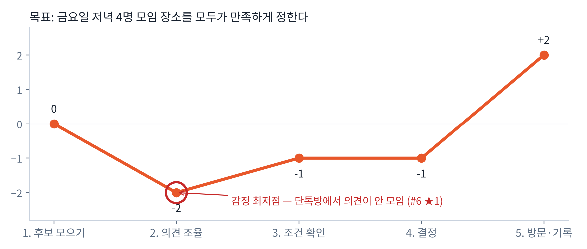

# 3단계 · 사용자 저니 — 현재(As-Is): 단톡방 + Beli로 식당 정하기

**퍼소나**: 이서윤 (21, 동아리 총무)
**목표**: 금요일 저녁 4명 모임 장소를 모두가 만족하게 정한다

| 단계 | ① 약속 잡기 | ② 후보 모으기 | ③ 의견 조율 | ④ 조건 확인 | ⑤ 결정 | ⑥ 방문·기록 |
|---|---|---|---|---|---|---|
| **사용자 행동** | 단톡방에 "금요일 저녁 뭐 먹지?" | 각자 Beli·지도 링크를 단톡방에 공유 | 답장이 엇갈림, "아무거나", 읽씹 | 예산·거리·못 먹는 음식을 다시 물어봄, 지도 검색 | 서윤이 한 곳을 골라 통보 | 식당 방문 후 Beli에 기록 |
| **생각** | "이번엔 빨리 정하자" | "다들 자기 1등만 올리네" | "또 30분째…" | "누가 해산물 못 먹었더라?" | "싫다는 사람 없겠지…" | "맛있었다! 기록해야지" |
| **감정** | 🙂 +1 | 😐 0 | 😫 **−3 (최저점)** | 😟 −2 | 😕 −1 | 😄 +2 |
| **관련 리뷰** | — | R1 ★5 "친구들이 남긴 평점을 더 신뢰" | **R6 ★1** "그냥 친구들에게 직접 물어보면 되잖아요" | R6 ★1 "검색 영역을 눌러도 아무것도 안 나와요" · R5 ★3 "평균 평점 같은 건 누구나 볼 수 있어야" | R4 ★3 "비교 대상이 되는 식당들을 기억하기가 정말 어렵거든요" | R3 ★4 "친구들은 … 후기를 올리는 걸 정말 좋아해요" |
| **Pain Point** | — | 개인 순위끼리 비교 불가 | 결정 도구가 없어 대화로만 조율 | 조건이 흩어져 있음, 지도 무반응 | 기억에 의존, 한 사람이 책임 | — |
| **사용 기기** | 스마트폰 (카카오톡) | 스마트폰 (Beli · 지도) | 스마트폰 (카카오톡) | 스마트폰 (지도 · Beli) | 스마트폰 (카카오톡) | 스마트폰 (Beli) |
| **AI 활용 기회** | 모임 시간·인원으로 그룹 자동 생성 | 멤버들의 취향 기록을 모아 후보 자동 추천 | **A vs B 배틀로 취향을 빠르게 수집해 합의** | 예산·지역·못 먹는 음식을 자동으로 걸러냄 | 추천 이유와 멤버별 만족도 설명 | 방문 결과로 다음 추천 개선 |
| **어긴 원칙** | — | P06 (각자 기억한 순위) | **P01** 결정 진행 상태가 안 보임 · **P07** 결정 지름길 없음 | **P05** 조건을 먼저 안 보여줌 · **P09** 지도 빈 화면 | **P06** 기억에 의존 · **P10** 이유 설명 없음 | — |
| **필요한 데이터** | 멤버 목록, 날짜·시간 | 멤버별 저장·방문 식당 | 라운드별 A/B 선택 | 예산, 지역, 못 먹는 음식 | 매치 점수, 추천 이유, 멤버별 만족도 | 최종 선택, 방문 여부 |
| **v2 화면** | S1 홈 | S2 그룹 | **S3 취향 배틀** | S2② 조건 요약 · S2-a 설정 시트 | **S4 AI 추천** | S1 지난 선택 탭 |

## 감정 최저점
**③ 의견 조율 (−3)** — 결정 도구가 없어 단톡방 대화로만 조율하다 보니 시간이 길어지고 책임이 한 사람(서윤)에게 몰린다.
→ v2는 이 단계를 **S3 취향 배틀**로 바꿔, 대화 대신 3라운드 선택으로 모두의 취향을 모은다.
